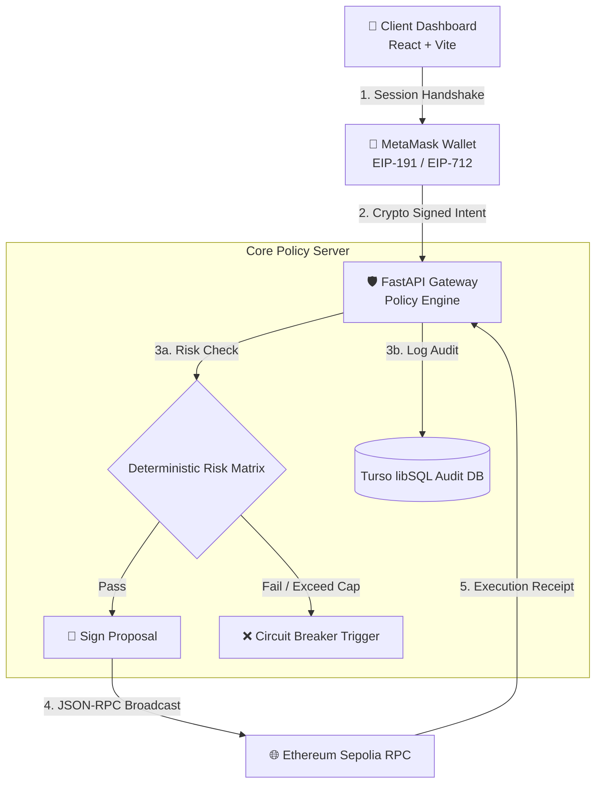

Here is the **entire, single block**. Click the **Copy** button in the top-right corner of the code block below, paste it straight into your GitHub `README.md` editor, and click **Commit changes**:

```markdown
<div align="center">


```

█████╗  ██████╗ ███████╗███╗   ██╗████████╗    ██╗   ██╗█████╗ ██╗   ██╗██╗  ██╗████████╗
██╔══██╗██╔════╝ ██╔════╝████╗  ██║╚══██╔══╝    ██║   ██║██╔══██╗██║   ██║██║  ██║╚══██╔══╝
███████║██║  ███╗█████╗  ██╔██╗ ██║   ██║       ██║   ██║███████║██║   ██║███████║   ██║

██╔══██║██║   ██║██╔══╝  ██║╚██╗██║   ██║       ╚██╗ ██╔╝██╔══██║██║   ██║██╔══██║   ██║

██║  ██║╚██████╔╝███████╗██║ ╚████║   ██║        ╚████╔╝ ██║  ██║╚██████╔╝██║  ██║   ██║

╚═╝  ╚═╝ ╚═════╝ ╚══════╝╚═╝  ╚═══╝   ╚═╝         ╚═══╝  ╚═╝  ╚═╝ ╚═════╝ ╚═╝  ╚═╝   ╚═╝

```

### ⚡ Zero-Trust Autonomous On-Chain AI Wallet Architecture

[](https://agent-wallet-xi.vercel.app)
[](https://sepolia.etherscan.io)
[](#-key-security--governance-guarantees)
[](./LICENSE)

---

**🏆 2026 Shenzhen International FinTech Competition (FinTechathon)**  
*Track F: Autonomous On-Chain Wallet Agent Infrastructure*

[🌐 Live App Gateway](https://agent-wallet-xi.vercel.app) • [⚡ Backend API Engine](https://agent-wallet-6oou.onrender.com) • [📜 Sepolia Etherscan](https://sepolia.etherscan.io)

</div>

---

## 🌟 Visual Overview & Metrics

<div align="center">

| 🔒 **Security Protocol** | ⚡ **Execution Speed** | 📊 **Audit Capability** | 🌐 **Chain Support** |
| :---: | :---: | :---: | :---: |
| **EIP-712 + Policy Gate** | **< 1.2s Latency** | **Turso libSQL Append-Only** | **EVM (Sepolia Testnet)** |

</div>

---

## 🏗️ Interactive System Architecture



---

## ✨ Core Pillars & Innovation Highlights

```text
┌─────────────────────────────────────────────────────────────────────────┐
│ 🛡️ ZERO-KNOWLEDGE KEY ISOLATION                                         │
│ Private keys never reach the backend server or AI reasoning modules.     │
│ Transactions are constructed as proposals and signed strictly client-side.│
└─────────────────────────────────────────────────────────────────────────┘
┌─────────────────────────────────────────────────────────────────────────┐
│ ⚡ DETERMINISTIC CIRCUIT BREAKER                                        │
│ Natural language AI intent is treated as untrusted input. Backend policy │
│ rules enforce hard value caps before generating EIP-712 payloads.       │
└─────────────────────────────────────────────────────────────────────────┘

```

---

## 📄 Official Competition Submission Dossiers

The formal competition dossiers required by the contest board are available directly in this repository:

* 📄 **`Technical documentation.docx`** — Deep-dive system architecture, threat model, and algorithm designs.
* 📄 **`Source code.docx`** — Directory layout, codebase walk-through, and environment variables.
* 📄 **`Execution evidence.docx`** — On-chain Sepolia hashes, sandbox execution logs, and API status.
* 📄 **`Security self assessment report.docx`** — Permission-tier matrix and vulnerability mitigations.

---

## ⚡ Quick Start & Development Setup

### 1. Backend Service

```bash
cd backend
python -m venv venv
source venv/bin/activate  # On Windows: venv\Scripts\activate
pip install -r requirements.txt

# Launch FastAPI Local Engine
uvicorn backend.app.main:app --host 0.0.0.0 --port 8080 --reload

```

### 2. Frontend Dashboard

```bash
cd ../frontend
npm install
npm run dev

```

---

Designed & Built with ❤️ for the **2026 Shenzhen International FinTech Competition**.
