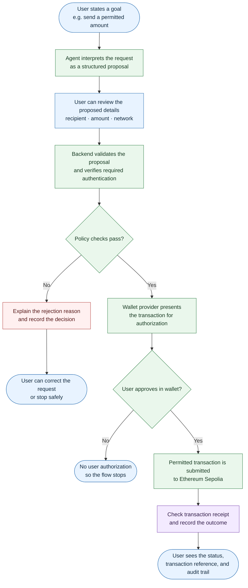
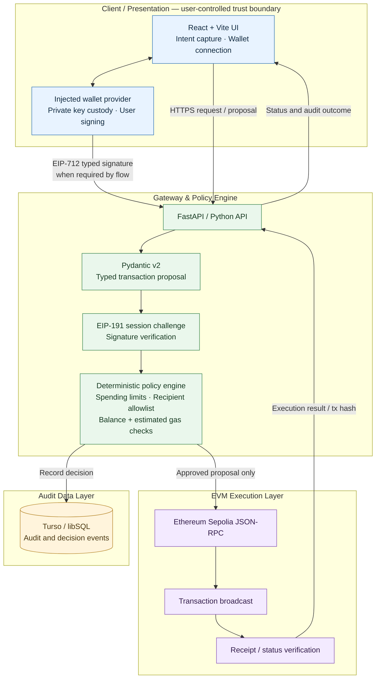
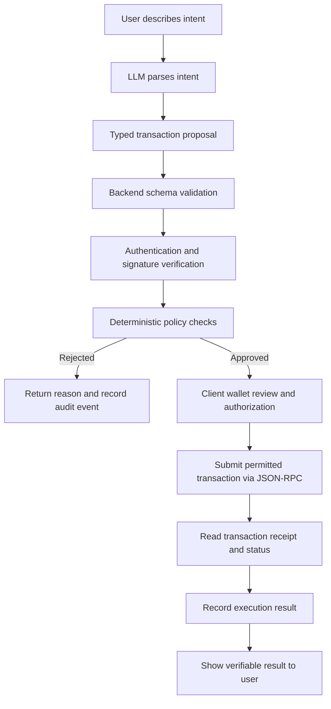

<div align="center">

# 🛡️ AGENT VAULT
### Enterprise-Grade Autonomous On-Chain AI Wallet Engine

[](https://agent-wallet-xi.vercel.app)
[-blue?style=for-the-badge&logo=ethereum)](https://sepolia.etherscan.io)
[](./LICENSE)
[](https://fastapi.tiangolo.com/)
[](https://react.dev/)

**2026 Shenzhen International FinTech Competition (FinTechathon) Submission**  
*Track F: Autonomous On-Chain Wallet Agent Infrastructure*

</div>

---

## 📌 Executive Summary

**Agent Vault** is a policy-gated autonomous AI wallet framework for EVM-compatible blockchains. It separates natural-language intent interpretation from transaction authorization and financial execution. An AI model may help convert a user's request into a typed transaction proposal, but it does not receive wallet signing authority. A deterministic backend policy gate evaluates the proposal against configured financial and structural constraints before the client-authorized transaction can proceed.

The design combines wallet-based authentication, EIP-712 structured signatures, deterministic risk checks, an auditable event trail, and Ethereum Sepolia testnet execution. Its core principle is simple:

> **AI can propose. Policy decides. The wallet owner authorizes. The blockchain settles.**

Agent Vault is intended as a security-focused prototype and competition submission. Testnet operation is not evidence of a production security audit or a guarantee of safety on mainnet.

---

## 🌐 Live Systems

| Component | Provider / Infrastructure | Role | Link |
|---|---|---|---|
| **Frontend dashboard** | Vercel | React/Vite wallet interface | [agent-wallet-xi.vercel.app](https://agent-wallet-xi.vercel.app) |
| **Backend API** | Render | FastAPI gateway and policy engine | [agent-wallet-6oou.onrender.com](https://agent-wallet-6oou.onrender.com) |
| **Audit ledger** | Turso / libSQL | Persistent audit events | Configured service; credentials are not public |
| **Execution network** | Ethereum Sepolia | Testnet transaction settlement | [Sepolia Etherscan](https://sepolia.etherscan.io) |

**Network:** Ethereum Sepolia, chain ID `11155111`.

The links above identify the supplied deployment endpoints. Current uptime, successful transaction history, and individual transaction confirmations should be checked directly against the live services and explorer.

---

## 🎯 Problem & Design Goals

Autonomous wallet agents create a trust-boundary problem: a language model is useful for interpreting flexible user instructions, but probabilistic text generation should not be treated as transaction authorization.

Agent Vault is designed to:

- Translate natural-language requests into strict transaction proposal schemas.
- Keep private-key custody in the user's wallet provider rather than the backend.
- Validate proposed transfers with deterministic policy checks.
- Apply single-transaction and cumulative daily spending limits.
- Restrict recipients using an allowlist unless policy explicitly permits broader access.
- Check whether the wallet balance can cover the proposed transfer and estimated gas.
- Record security-relevant decisions and execution events for later review.
- Use Ethereum Sepolia for testnet transaction flows.

The system is not a replacement for wallet-owner review, security audits, or operational controls.

---

## 🙋 How Users Benefit from Agent Vault

Agent Vault is designed to help users turn a wallet instruction into a reviewable, policy-checked transaction flow—without handing their private keys to the backend.



### Practical user value

- **More control:** transaction details are represented in a structured proposal before execution.
- **Policy guardrails:** configured per-transaction limits, cumulative daily limits, recipient restrictions, and balance-plus-gas checks can reject proposals that do not meet policy.
- **Private-key separation:** signing remains with the user's injected wallet provider; the backend is not designed to take custody of the user's private key.
- **Clearer failure handling:** rejected proposals can return a reason instead of silently proceeding.
- **Traceability:** audit events and blockchain transaction references help users and operators inspect what happened.
- **Explicit authorization:** a policy approval is not the same as wallet approval or blockchain confirmation; those stages remain separate.

This diagram describes the intended user journey. Exact prompts, UI screens, and deployed behavior should be confirmed against the current application. The live environment listed by this README uses Ethereum Sepolia, a test network—not real-value production settlement.

---

## 🏗️ System Architecture

Agent Vault follows a decoupled, three-tier architecture with explicit trust boundaries.



### Tier 1 — Client and cryptographic boundary

The React/Vite client handles the user interface and wallet interaction. The wallet provider is responsible for private-key custody and signing. EIP-191 challenge-response signing can establish wallet ownership for a session; EIP-712 typed data can bind a signature to structured transaction intent.

A signature must be verified against the expected wallet address and the exact payload. The UI should clearly show what the user is being asked to sign.

### Tier 2 — Gateway and policy engine

The FastAPI backend validates requests and converts transaction proposals into typed schemas. Pydantic v2 models can enforce field types and structural constraints. The deterministic policy engine evaluates financial limits and recipient restrictions independently of the language model's output.

The backend also records relevant authentication, policy, rejection, and execution events in the audit store.

### Tier 3 — Blockchain execution

The execution layer communicates with Ethereum Sepolia through JSON-RPC. It prepares and submits permitted transaction flows, then checks the resulting transaction status and receipt. A transaction should not be described as confirmed until the chain provides the corresponding evidence.

---

## 🔐 Security Model and Trust Boundaries

### AI is an intent compiler, not a signer

The LLM's role is limited to interpreting user intent and producing a proposed transaction representation. Its output is untrusted input. It cannot override policy limits, authorize its own proposal, or obtain signing authority merely by generating a valid-looking payload.

### Client-side key custody

The documented design keeps user private keys in the injected wallet provider, such as MetaMask. The backend should never request, log, or persist seed phrases or private keys.

### Wallet challenge-response authentication

The technical design describes wallet-signed nonces for session authentication and short-lived JWT sessions with HMAC-SHA256 verification. Implementations should enforce nonce expiration and one-time use, bind the signed message to the expected domain and chain context, and protect session secrets.

### Defense in depth

The security blueprint includes strict transport-security headers, dynamic CORS configuration, payload sanitization, typed request validation, deterministic policy checks, and audit logging. These controls should be verified in deployment configuration and tests rather than assumed solely from architectural intent.

---

## ⚙️ Transaction Policy Engine

Before a transaction proposal is eligible to proceed, the backend applies deterministic checks. The supplied technical specification defines the following policy sequence:

1. **Single-transaction ceiling** — reject a proposal whose amount exceeds the configured maximum.
2. **Daily spending limit** — reject if prior daily spending plus the proposed amount exceeds the configured daily limit.
3. **Recipient allowlist** — when unrestricted recipients are not explicitly enabled, reject recipients not present in the normalized allowlist.
4. **Balance and gas check** — reject if the native-token balance cannot cover the proposed amount plus estimated gas.

Conceptual Python example adapted from the technical specification:

```python
from decimal import Decimal
from typing import NamedTuple


class ExecutionVerdict(NamedTuple):
    approved: bool
    reason: str


def evaluate_autonomous_transaction(
    proposal_amount: Decimal,
    recipient: str,
    user_daily_spent: Decimal,
    user_native_balance: Decimal,
    policy_max_tx: Decimal,
    policy_daily_limit: Decimal,
    policy_allowlist: set[str],
    allow_any: bool,
    estimated_gas: Decimal,
) -> ExecutionVerdict:
    if proposal_amount > policy_max_tx:
        return ExecutionVerdict(
            False,
            f"Rejected: amount exceeds single-transaction ceiling ({policy_max_tx} ETH).",
        )

    if user_daily_spent + proposal_amount > policy_daily_limit:
        return ExecutionVerdict(
            False,
            f"Rejected: exceeds daily cumulative limit ({policy_daily_limit} ETH).",
        )

    normalized_recipient = recipient.lower()
    normalized_allowlist = {address.lower() for address in policy_allowlist}
    if not allow_any and normalized_recipient not in normalized_allowlist:
        return ExecutionVerdict(
            False,
            "Rejected: recipient is not on the configured allowlist.",
        )

    if user_native_balance < proposal_amount + estimated_gas:
        return ExecutionVerdict(
            False,
            "Rejected: insufficient balance for amount and estimated gas.",
        )

    return ExecutionVerdict(
        True,
        "Approved: proposal passed the deterministic policy checks.",
    )
```

This snippet illustrates the documented policy logic; it is not a claim that this exact function is the deployed implementation. A production implementation should also validate positive amounts, address syntax and checksum, token decimals, chain ID, gas-price assumptions, token-specific transfer behavior, and race conditions in daily-limit accounting.

**Important:** a policy approval means only that the proposal passed the configured checks. It does not itself prove that a transaction was signed, broadcast, mined, or finalized.

---

## 🔄 Dual-Phase Execution Workflow



The key separation is between **proposal**, **policy approval**, **wallet authorization**, and **on-chain settlement**. These are distinct states and should be represented separately in both the UI and audit trail.

---

## 🧾 Audit Ledger

Turso / libSQL is used as the documented audit data layer. The design calls for recording security-relevant events such as:

- Authentication challenges and verification outcomes.
- Parsed transaction proposals and policy decisions.
- Rejected proposals and their reasons.
- Signature-verification results.
- Transaction identifiers and execution outcomes.

The technical specification describes the audit trail as append-only. To preserve that property, application permissions and database operations must prevent ordinary application flows from silently modifying or deleting prior events. Sensitive information—including tokens, credentials, private keys, and unnecessary personal data—must not be written to logs.

The database should be treated as an application audit store, not as a substitute for independently verifiable on-chain transaction records.

---

## 🌐 API and Data Contracts

The backend is described as a FastAPI service using Pydantic v2 transaction-proposal models. The exact deployed route list and request/response schemas were not included in the supplied technical specification, so this README does not invent endpoint paths.

For each API route, document the following in the source repository or generated OpenAPI specification:

| Contract element | What to specify |
|---|---|
| Method and path | Exact HTTP method and route |
| Authentication | Required wallet session or signature |
| Request schema | Required fields, types, units, and constraints |
| Response schema | Stable response fields and status meanings |
| Failure cases | Validation, policy, RPC, and upstream errors |
| Audit behavior | Events written for accepted and rejected requests |

FastAPI commonly exposes interactive API documentation at `/docs` and an OpenAPI schema at `/openapi.json` when those routes have not been disabled. Check the deployed backend configuration to confirm availability.

---

## 🧰 Technology Stack

| Layer | Technologies |
|---|---|
| Frontend | React 18, Vite |
| Wallet / cryptography | Injected Web3 provider, EIP-191 challenge signing, EIP-712 typed data |
| Backend | Python, FastAPI, Pydantic v2, Web3.py |
| Session design | Signed wallet nonce, short-lived JWT, HMAC-SHA256 verification |
| Audit storage | Turso / libSQL |
| Blockchain | Ethereum Sepolia, chain ID `11155111`, JSON-RPC |
| Frontend hosting | Vercel |
| Backend hosting | Render |

---

## 🚀 Local Development

The supplied documentation identifies the frontend and backend technologies but does not provide the repository's exact file tree, dependency manifests, or environment-variable names. The following is a general setup outline; use the repository's actual scripts and configuration as the source of truth.

### Prerequisites

- Node.js and npm compatible with the frontend's `package.json`.
- Python version compatible with the backend's dependency manifest.
- A Web3 wallet such as MetaMask configured for Ethereum Sepolia.
- Sepolia test ETH for transaction testing.
- RPC and Turso credentials if required by the selected local configuration.

### Frontend

```bash
npm install
npm run dev
```

Run these commands from the frontend directory containing `package.json`. If the repository uses a different workspace or package manager, follow its project configuration.

### Backend

Create and activate a virtual environment, then install the dependencies listed in the backend's dependency file:

```bash
python -m venv .venv

# macOS / Linux
source .venv/bin/activate

# Windows PowerShell
# .\.venv\Scripts\Activate.ps1

pip install -r requirements.txt
```

Start the FastAPI application using its actual module path. For example, if the application object is `app` in `main.py`:

```bash
uvicorn main:app --reload
```

`main:app` is an example only; replace it with the module and application name used in the repository.

### Environment configuration

Configure deployment secrets through local environment variables or the hosting provider's secret manager. Actual variable names should match the codebase.

Typical configuration categories include:

- Ethereum Sepolia JSON-RPC endpoint.
- Turso database URL and authentication token.
- Session/JWT signing secret.
- Allowed frontend origins for CORS.
- Policy limits and recipient allowlist.
- Frontend API base URL.

Do not commit `.env` files, RPC credentials, database tokens, JWT secrets, seed phrases, or private keys.

---

## ☁️ Deployment

### Frontend — Vercel

Deploy the React/Vite application and configure its build command, output directory, and backend API base URL according to the repository's frontend setup.

### Backend — Render

Deploy the FastAPI service with the correct application start command. Configure database connectivity, RPC access, CORS origins, and session secrets in the service's environment settings.

### Audit store — Turso

Configure the database URL and authentication token using the exact variable names expected by the backend. Use least-privilege access and rotate credentials if exposure is suspected.

### Blockchain — Sepolia

Confirm the wallet and backend are targeting chain ID `11155111`. Use testnet funds only. Verify transaction hashes and receipts through an explorer rather than relying exclusively on a frontend success message.

---

## 🧪 Testing and Verification Checklist

Before using the system for a demonstration, test both successful and rejected paths.

- [ ] Wallet connection identifies the expected account and chain.
- [ ] Authentication nonce is unique, expires, and cannot be replayed.
- [ ] Signatures are checked against the exact intended message or typed data.
- [ ] Malformed transaction proposals fail schema validation.
- [ ] Amounts above the single-transaction ceiling are rejected.
- [ ] Proposals exceeding the daily limit are rejected.
- [ ] Non-allowlisted recipients are rejected when allowlisting is enabled.
- [ ] Insufficient native-token balance, including gas, is rejected.
- [ ] Prompt injection or conflicting natural-language instructions cannot override policy.
- [ ] Rejections and execution outcomes are recorded in the audit trail.
- [ ] RPC failures and pending transactions are shown accurately.
- [ ] Transaction receipts are checked before displaying confirmed status.
- [ ] Secrets are absent from source control, client bundles, and logs.

---

## 📈 Operational Status and Limitations

The project information supplied for this README identifies live frontend and backend URLs and a Sepolia execution environment. It does not include independent security-audit results, load-test reports, formal verification, or verified production service-level objectives.

Accordingly:

- “Live” links should not be interpreted as a guarantee of continuous uptime.
- Sepolia transactions are testnet activity and do not demonstrate mainnet readiness.
- A deterministic policy gate reduces certain risks but cannot eliminate every wallet, contract, RPC, application, or social-engineering risk.
- The architecture describes intended security controls; each must be verified against the deployed code and configuration.
- No model-accuracy or security-performance metrics are asserted here because no supporting measurements were provided.

---

## 🗺️ Development Roadmap

Suggested next steps for hardening and documenting the system:

1. Publish the exact API route and schema reference from FastAPI/OpenAPI.
2. Add automated tests for policy boundaries, nonce replay, malformed signatures, and prompt-injection attempts.
3. Make transaction state transitions explicit: proposed, rejected, approved, awaiting wallet authorization, submitted, mined, and failed.
4. Strengthen audit-log integrity controls and define retention policies.
5. Add monitoring for RPC failures, delayed receipts, database errors, and policy rejections.
6. Complete an independent security review before considering mainnet use.
7. Document threat models, supported transaction types, known limitations, and incident response procedures.

---

## 🏁 Competition Submission

**Event:** 2026 Shenzhen International FinTech Competition (FinTechathon)  
**Track:** F — Autonomous On-Chain Wallet Agent Infrastructure  
**Project:** Agent Vault — Autonomous On-Chain Security & Execution Layer

Agent Vault explores how autonomous agents can interact with blockchain systems while keeping financial authority bounded by explicit policy, user-held keys, cryptographic verification, and auditable execution.

---

## 📄 License

The supplied project description identifies the license as MIT. Ensure the repository's `LICENSE` file contains the corresponding license text before distributing the project.

---

## ⚠️ Security Disclaimer

Agent Vault is a software prototype and technical demonstration, not financial advice or a guarantee against loss. Do not use it to safeguard material funds without a thorough code review, threat modeling, comprehensive testing, and independent security assessment. Never share seed phrases or private keys. Use Ethereum Sepolia test assets during development and demonstrations.

---

<div align="center">

**Agent Vault — AI proposes. Deterministic policy protects. The user controls the keys.**

</div>
